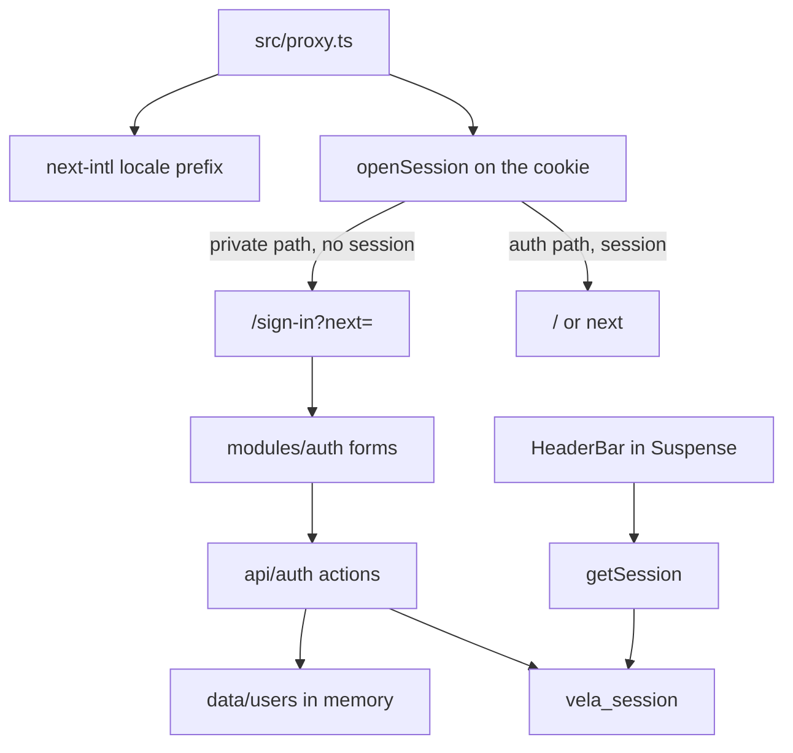

# Phase 6 — Auth (implementation plan)

Simulated student session: sign-in and sign-up forms, a signed cookie, proxy guards, and the header account controls. Pending and inline errors ship with the forms. Each auth route gets `loading.tsx` and `error.tsx`.

Stop when this phase is done. No dashboard, enrollment, or real password storage.

**Already in the repo (do not rewrite):** the app shell, home, catalog, course detail, `paths.signIn` / `paths.signUp` / `paths.dashboard` / `paths.learn` / `paths.checkout`, and `src/proxy.ts` as the next-intl locale proxy. Private pages do not exist yet.

**Before writing Next.js APIs:** `cookies()` is request-time. With Cache Components it stays inside `<Suspense>` or the build cannot prerender the shell. The header already suspends for `usePathname`; the session read joins that boundary. `proxy.ts` stays the only proxy file (not `middleware.ts`). It may read the request cookie. It does not import `src/data` or call `cookies()` from `next/headers`. Server Actions set the cookie; a render must not. `redirect` comes from `@/i18n/navigation` so the locale prefix is kept. Do not call `new Date()` in a cached or prerendered module. Sealing a cookie uses `Date.now()` only inside the action and when opening a cookie on a request.



## Target tree (new or changed)

```
src/content/en.json, ar.json
src/data/users.ts
src/lib/session.ts
src/lib/auth-routes.ts
src/lib/auth-fields.ts
src/api/session.ts
src/api/students.ts
src/api/auth.ts
src/proxy.ts
src/modules/auth/
src/components/site-header/          (account menu + session slot)
src/app/[locale]/sign-in/page.tsx, loading.tsx, error.tsx
src/app/[locale]/sign-up/page.tsx, loading.tsx, error.tsx
```

No new dependency. No Zod, no auth library, no `middleware.ts`.

## Step 1 — Branch

Branch from current `master`: `feat/phase-06-auth`.

## Step 2 — Copy

`brandName` stays `"Vela"`.

| Key                         | EN (intent)                                      |
| --------------------------- | ------------------------------------------------ |
| `shell.accountNav`          | Account                                          |
| `shell.signIn`              | Sign in                                          |
| `shell.signUp`              | Create account                                   |
| `shell.signOut`             | Sign out                                         |
| `shell.signOutPending`      | Signing out                                      |
| `auth.signIn.title`         | Sign in                                          |
| `auth.signIn.description`   | Sign in to your Vela account.                    |
| `auth.signIn.submit`        | Sign in                                          |
| `auth.signIn.pending`       | Signing in                                       |
| `auth.signIn.demo`          | Demo student:                                    |
| `auth.signIn.demoPassword`  | Password:                                        |
| `auth.signIn.createAccount` | Create an account                                |
| `auth.signUp.title`         | Create an account                                |
| `auth.signUp.description`   | Create a simulated Vela account for this demo.   |
| `auth.signUp.submit`        | Create account                                   |
| `auth.signUp.pending`       | Creating account                                 |
| `auth.signUp.hasAccount`    | Already have an account?                         |
| `auth.signUp.signIn`        | Sign in                                          |
| `auth.fields.*`             | Name, Email, Password, Confirm password          |
| `auth.errors.name`          | Enter a name, 2 to 80 characters.                |
| `auth.errors.email`         | Enter a valid email address.                     |
| `auth.errors.password`      | Use 8 to 72 characters.                          |
| `auth.errors.confirm`       | Those passwords don't match.                     |
| `auth.errors.credentials`   | That email or password doesn't match.            |
| `auth.errors.taken`         | That email is already registered.                |

Arabic: equivalent UI strings. **Vela** stays in the descriptions. The demo email and password are not copy; the sign-in page reads them from the store.

## Step 3 — Simulated students and session

[src/data/users.ts](../src/data/users.ts) is an in-memory list. Passwords are plaintext because this phase is a demo, and they never go into the cookie.

Seed student (always present, including after a process restart):

| Field    | Value                 |
| -------- | --------------------- |
| Name     | Amira Hassan          |
| Email    | `amira@vela.example`  |
| Password | `vela-demo`           |

`authenticate` returns `{ id, name, email }` or `null` (unknown email and wrong password look the same). `registerStudent` adds a student for this process and returns `null` when the email is taken. Restarting the server drops everyone except the seed. A cookie that was already issued still opens until it expires, because the cookie itself is the session.

[src/lib/session.ts](../src/lib/session.ts) seals `{ id, name, email, exp }` with HMAC-SHA256 and a demo key constant (no env file). Cookie name `vela_session`: httpOnly, SameSite=Lax, path `/`, 7 days. `secure` only when `NODE_ENV` is production, so `next dev` on http can keep it. `openSession` returns `null` for a missing, tampered, or expired token. The header displays `name`; the password is not sealed.

[src/api/session.ts](../src/api/session.ts) `getSession()` reads that cookie. React `cache()` dedupes it for the render. [src/api/students.ts](../src/api/students.ts) `getDemoStudent()` returns the seed email and password for the sign-in hint. It does not touch `cookies()`, so the sign-in page can still prerender.

[src/api/auth.ts](../src/api/auth.ts) is `"use server"`: `signIn`, `signUp`, `signOut`. Field checks live in [src/lib/auth-fields.ts](../src/lib/auth-fields.ts) and return error keys, not English sentences. The form translates the keys.

- Name: trim, collapse whitespace, 2–80 characters, no control characters.
- Email: trim, lowercase, simple `a@b.c` shape, max 254.
- Password: 8–72 characters, not trimmed.
- Confirm, on sign-up, must equal the password.
- Sign-in failure: `credentials`. Sign-up duplicate: `taken`.
- Success sets the cookie and redirects to a safe `next` path, otherwise home. The locale is a hidden field (`useLocale`). `getLocale()` reads `next/root-params`, which a server action cannot call.
- Sign-out deletes the cookie and redirects home.

[src/lib/auth-routes.ts](../src/lib/auth-routes.ts) `safeNextPath` accepts only a locale-unprefixed private path (`/dashboard`, `/learn/...`, `/checkout/...`). Anything with a scheme, `//`, `..`, or `%` is dropped.

## Step 4 — Proxy guards

[src/proxy.ts](../src/proxy.ts) still calls next-intl's `createMiddleware`. Unprefixed paths (`/`, `/sign-in`) go there first so the guard always sees `/en` or `/ar`.

| Request                                      | Session | Result                                      |
| -------------------------------------------- | ------- | ------------------------------------------- |
| `/dashboard`, `/learn`, `/checkout` (prefix) | no      | `/{locale}/sign-in?next={path}`             |
| `/sign-in`, `/sign-up`                       | yes     | `/{locale}{next}` when safe, otherwise home |
| Anything else                                | either  | locale proxy only                           |

The guard uses `openSession` on the request cookie. It does not read the student list. A signed-in visit to a private path that has no page yet still reaches the locale not-found, with the shell.

## Step 5 — Forms

[src/modules/auth/](../src/modules/auth/) holds the two pages. Routes only render the module. One `getTranslations()` in the page module. The forms are the client boundary (`useActionState`). `searchParams` is awaited in a child under `<Suspense>` so the heading can prerender. `noValidate` so the locale strings are the errors, not the browser's.

- Content width `max-w-6xl` and `px-4`. The form column is `max-w-md`.
- `h1` is the page title. The form uses `aria-labelledby`. Document title is `Vela · {title}` (`absolute`).
- Each control has a visible `<label>`, `aria-required`, `aria-invalid`, and `aria-describedby` when that field has an error. Errors use `role="alert"`.
- Email and password inputs are `dir="ltr"`. The name input and the header name are `dir="auto"`.
- `autocomplete`: `name`, `email`, `current-password` on sign-in, `new-password` on sign-up (including confirm).
- Submit is disabled while pending, the label switches to the pending string, and a polite status repeats it for assistive tech. `aria-busy` on the form.
- After a failed submit, focus moves to the first invalid field, or to the form alert when the failure is `credentials` or `taken`.
- Typed values stay. The fields are controlled because React clears a form when the action finishes, including when it returns an error.
- Sign-in shows the demo email and password with `dir="ltr"`.
- Each form links to the other and keeps a safe `next` query. The link is not the submit control.
- **Empty / invalid:** field errors, no session cookie.
- **Wrong password or unknown email:** `credentials`.
- **Email already in the list:** `taken`.

## Step 6 — Header

The account controls are not part of `primaryNavItems` (the footer stays Home and Courses).

[src/components/site-header/index.tsx](../src/components/site-header/index.tsx) renders an async child inside the existing Suspense boundary. That child calls `getSession()` and passes the result into the client header.

- Signed out, from `md` up: an `Account` nav (`shell.accountNav`) with Sign in and Create account. `aria-current="page"` when that path is active.
- Signed in: the student name (`translate="no"`, `dir="auto"`) and a Sign out form. The pending label comes from `useFormStatus` inside that form.
- Narrow: those controls move into the mobile dialog so the bar does not overflow. Dialog links close the dialog. Sign out stays mounted until the session prop changes, then the dialog closes, so unmounting does not cancel the action.
- Distinct names: main nav vs account nav.

## Step 7 — Loading and error

[src/app/[locale]/sign-in/loading.tsx](../src/app/[locale]/sign-in/loading.tsx) and the sign-up twin: skeleton of the title, intro, fields (2 vs 4), and button. Sign-in also reserves the demo hint. `role="status"` with the existing sr-only `loading.label`. `aria-hidden` on the decorative bars only. The searchParams fallback inside the page is the fields only, so the heading is not duplicated.

[src/app/[locale]/sign-in/error.tsx](../src/app/[locale]/sign-in/error.tsx) and the sign-up twin: same message, `retry`, and visible `brandName` as the catalog error, at the same content width. One `useTranslations()`.

No `not-found.tsx` on these segments. They do not call `notFound()`.

## Step 8 — Docs (after the code)

- This plan stays.
- Link it from [roadmap.md](roadmap.md).
- Short note in [architecture.md](architecture.md): simulated cookie session, in-memory students, proxy guards, header slot.
- Short note in [i18n.md](i18n.md): `auth` vs `shell` copy, `dir` on credentials and names, error keys, `next` is unprefixed.

Comments only where non-obvious (demo HMAC key, plaintext in-memory list, proxy checks the cookie not the list, `secure` off on local http, Suspense around `cookies()`, `next` is a private path).

## Step 9 — Verify (required before calling the phase done)

Run `npm run dev` and `npm run build`. In the browser:

1. `/en/sign-in` and `/ar/sign-in` render the form in that locale. **Vela** stays untranslated. Arabic sets `dir="rtl"`. The demo email and password read left to right.
2. Empty submit shows the field errors and moves focus to the first invalid field. No browser-native validation bubble.
3. A wrong password shows the credentials error. The demo student signs in, lands on home, and the header shows Amira Hassan plus Sign out.
4. Sign out returns home and the header shows Sign in and Create account again.
5. While signed out, `/en/dashboard`, `/en/learn/x/y`, and `/en/checkout/demo` redirect to sign-in with `next` set to that path. A garbage cookie does not count as a session.
6. After signing in from that redirect, the private path that has no page yet shows the locale not-found inside the shell, and the header still shows the student.
7. While signed in, `/sign-in` and `/sign-up` redirect home. `next` pointing at an external URL is ignored.
8. Sign up with a new name and email, sign out, and sign in again with that password. Signing up with the demo email shows the taken error. Mismatched passwords show the confirm error.
9. The language switch on a sign-in URL with `next` stays on that path and query. Header Sign in is the current page on the sign-in URL. Footer links stay Home and Courses.
10. Narrow viewport: account controls are in the menu, and sign out from that menu completes. Desktop: account controls sit in the header. Focus-visible shows on the fields, links, and buttons.
11. Loading skeleton matches the form and exposes a status message. Error UI retries and shows Vela.
12. Home, catalog, and a course page still render. Production build succeeds with `cacheComponents`. The demo key is not in the client JS bundle.

Exercise both locales, a failed submit, the demo student, a new student, the guards, sign out, and desktop plus a narrow viewport.

## Out of scope

My learning dashboard and enroll (Phase 7), checkout (Phase 8), the player (Phase 9), reviews, password reset, email verification, OAuth, hashed passwords, a persistent user database, tests, git push.

## Git

Commit on `feat/phase-06-auth` after each finished concern (copy, session data and API, routes and header and proxy, loading/error, docs). Do not commit on `master` except the merge when the phase is done. Do not push. Do not edit the Next.js-managed `AGENTS.md` block.
