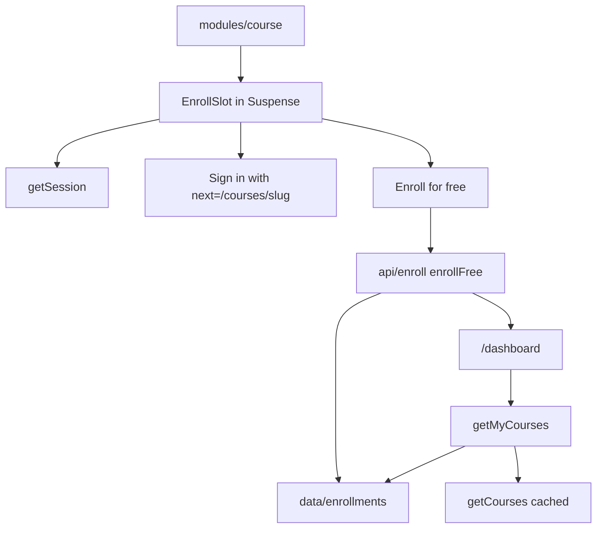

# Phase 7 — Enrollment (implementation plan)

Free enroll on a course, and a My learning dashboard that lists those courses. The dashboard ships with `loading.tsx`, `error.tsx`, and an empty state. The enroll control has a pending state.

Stop when this phase is done. No checkout, lesson player, progress, or unenroll.

**Already in the repo (do not rewrite):** the app shell, home, catalog, course detail, simulated session, and `src/proxy.ts`. `paths.dashboard` and `paths.course` exist. `/dashboard` is already a private path: a signed-out visit redirects to sign-in with `next=/dashboard`, and the page itself is still the locale not-found.

**Before writing Next.js APIs:** `cookies()` is request-time. With Cache Components it stays inside `<Suspense>` or the course page cannot prerender. The course facts, syllabus, and JSON-LD stay outside that boundary. The enroll slot is the child that reads the session. The dashboard heading can prerender; the list awaits the cookie under `<Suspense>`. Do not put enrollment rows behind `'use cache'` — they are per student and live in process memory. Do not call `new Date()`. Do not seal enrollments into the cookie. `redirect` comes from `@/i18n/navigation`. A server action cannot call `getLocale()`; the form posts the locale, same as sign-in.



## Target tree (new or changed)

```
src/content/en.json, ar.json
src/data/enrollments.ts
src/api/enrollments.ts
src/api/enroll.ts
src/lib/auth-routes.ts                         (course path is a safe next)
src/modules/course/enroll.tsx, enroll-form.tsx
src/modules/course/index.tsx
src/modules/learning/
src/components/site-header/account-menu.tsx
src/app/[locale]/dashboard/page.tsx, loading.tsx, error.tsx
```

No new dependency. Paid courses do not enroll. `/learn` stays a guarded path with no page.

## Step 1 — Branch

Branch from current `master`: `feat/phase-07-enrollment`.

## Step 2 — Copy

`brandName` stays `"Vela"`.

| Key                      | EN (intent)                                      |
| ------------------------ | ------------------------------------------------ |
| `shell.learning`         | My learning                                      |
| `learning.title`         | My learning                                      |
| `learning.intro`         | Free courses you enroll in show up here.         |
| `learning.count`         | `{count, plural, one {# course} other {# courses}}` |
| `learning.empty`         | You haven't enrolled in a course yet.            |
| `learning.browse`        | Browse courses                                   |
| `learning.enroll`        | Enroll for free                                  |
| `learning.enrollPending` | Enrolling                                        |
| `learning.enrollSignIn`  | Sign in to enroll                                |
| `learning.enrolled`      | You're enrolled.                                 |
| `learning.dashboard`     | Go to My learning                                |

Arabic: equivalent UI strings, including plural forms. **Vela** is not in these strings. The header label and the page title share the same words under different keys (`shell` vs `learning`), same as Sign in.

## Step 3 — Enrollment store and API

[src/data/enrollments.ts](../src/data/enrollments.ts) is an in-memory list of `{ userId, courseSlug }`. No seed rows, so the demo student starts from the empty dashboard. Restarting the server drops every row. A cookie that is still valid still opens; My learning is empty until that student enrolls again. The id is the one sealed in the cookie. This list does not look up `src/data/users.ts`.

`addEnrollment` is idempotent. `enrollmentSlugs` keeps insertion order. `hasEnrollment` is the course-page check.

[src/api/enrollments.ts](../src/api/enrollments.ts) `getMyCourses()` joins those slugs to `getCourses()` and skips a slug that is no longer in the catalog. `getEnrollmentState(slug)` returns `guest`, `enrolled`, or `open`. Both read `getSession()`. Neither uses `'use cache'`.

[src/api/enroll.ts](../src/api/enroll.ts) is `"use server"`: `enrollFree`.

- Slug: lowercase letters, digits, and single hyphens, max 80 characters. Anything else is ignored.
- No session: redirect to sign-in. `next` is `paths.course(slug)` when the slug is well-formed, otherwise sign-in with no `next`.
- Unknown slug, or `price !== 0`: return without writing a row. Checkout is a later phase.
- Free course: `addEnrollment`, then redirect to `paths.dashboard()`. A second submit does not add a second row; it still lands on the dashboard.

[src/lib/auth-routes.ts](../src/lib/auth-routes.ts) `safeNextPath` also accepts a locale-unprefixed course path (`/courses/{slug}`). Sign-in and sign-up already keep `next` and send a signed-in student there. Schemes, `//`, `..`, and `%` stay dropped. `/dashboard`, `/learn`, and `/checkout` stay the only private prefixes. The course page stays public.

## Step 4 — Course page

[src/modules/course/index.tsx](../src/modules/course/index.tsx) renders the enroll slot only when `price === 0`, inside `<Suspense>`. Paid courses keep the price and gain no control.

[src/modules/course/enroll.tsx](../src/modules/course/enroll.tsx) reads `getEnrollmentState`.

- **Guest:** link “Sign in to enroll” to sign-in with `next` set to this course. It is a link, not a submit.
- **Open:** [src/modules/course/enroll-form.tsx](../src/modules/course/enroll-form.tsx) posts `enrollFree`. The button is disabled while pending, the label switches to the pending string, and a polite status repeats it. `aria-busy` on the button.
- **Enrolled:** “You're enrolled.” and a link to the dashboard. No second enroll control.

The fallback is a button-sized bar. `role="status"` with the existing sr-only `loading.label`. `aria-hidden` on the bar only.

## Step 5 — My learning

[src/app/[locale]/dashboard/page.tsx](../src/app/[locale]/dashboard/page.tsx) renders the module. Document title is `Vela · {title}` (`absolute`).

[src/modules/learning/index.tsx](../src/modules/learning/index.tsx) is a Server Component. One `getTranslations()` in each component. No extra `<main>`.

- Content width `max-w-6xl` and `px-4`.
- `h1` is the page title, with the intro under it. Both sit outside Suspense.
- The list awaits the session under Suspense. No session (the proxy should already have redirected): redirect to sign-in with `next=/dashboard`.
- **Empty:** `learning.empty` and a link to `paths.catalog()`.
- **Courses:** `learning.count`, then the same `CourseCard` grid as the home featured list. The title links to the course. No lesson links and no progress.

## Step 6 — Header

My learning is not part of `primaryNavItems`. The footer stays Home and Courses.

[src/components/site-header/account-menu.tsx](../src/components/site-header/account-menu.tsx): when there is a session, the account landmark includes the dashboard link (`shell.learning`), the student name, and Sign out. `aria-current="page"` when the path is exactly the dashboard. The link closes the mobile dialog. Signed out, the account nav stays Sign in and Create account.

## Step 7 — Loading and error

[src/app/[locale]/dashboard/loading.tsx](../src/app/[locale]/dashboard/loading.tsx): skeleton of the title, intro, and course cards. `role="status"` with the existing sr-only `loading.label`. `aria-hidden` on the decorative bars only. The Suspense fallback inside the page is the cards only, so the heading is not duplicated.

[src/app/[locale]/dashboard/error.tsx](../src/app/[locale]/dashboard/error.tsx): same message, `retry`, and visible `brandName` as the catalog error, at the same content width. One `useTranslations()`.

No `not-found.tsx` on this segment. It does not call `notFound()`.

## Step 8 — Docs (after the code)

- This plan stays.
- Link it from [roadmap.md](roadmap.md).
- Short note in [architecture.md](architecture.md): free enroll, in-memory rows, dashboard, Suspense around the session read. Paid courses are unchanged.
- Short note in [i18n.md](i18n.md): `learning` vs `shell.learning`, course `next` is an unprefixed path.

Comments only where non-obvious (memory is not the cookie, paid slug is ignored, Suspense so the course page still prerenders, course path as a safe `next`).

## Step 9 — Verify (required before calling the phase done)

Run `npm run dev` and `npm run build`. In the browser:

1. Signed out, a free course shows “Sign in to enroll”. A paid course shows the price and no enroll control. **Vela** stays untranslated. Arabic sets `dir="rtl"`.
2. That sign-in link opens sign-in with `next` set to the course. The demo student signs in and returns to that course.
3. “Enroll for free” shows the pending label, then My learning lists that course once. The card title opens the course. The course shows “You're enrolled.” and a link back to My learning.
4. Enrolling in the other free course adds a second card. Repeating an enrollment does not duplicate the row.
5. A new account’s dashboard is empty, with the browse link. The demo student can still reach the empty state before enrolling.
6. Signed out, `/en/dashboard` redirects to sign-in with `next=/dashboard`. After sign-in, the dashboard renders in the shell.
7. Header “My learning” is the current page on the dashboard and is absent when signed out. Footer links stay Home and Courses. The language switch stays on the dashboard.
8. Narrow viewport: My learning is in the menu and the enroll control fits. Desktop: My learning sits in the header. Focus-visible shows on the enroll control, the dashboard link, and the card title.
9. Dashboard loading skeleton matches the page and exposes a status message. Error UI retries and shows Vela.
10. Home, catalog, a course page, and sign-in still render. Production build succeeds with `cacheComponents`.

Exercise both locales, a free course, a paid course, the empty dashboard, a filled dashboard, and desktop plus a narrow viewport.

## Out of scope

Checkout and paid enrollment (Phase 8), the player and progress (Phase 9), reviews, unenroll, a persistent enrollment database, tests, git push.

## Git

Commit on `feat/phase-07-enrollment` after each finished concern (copy, enrollment data and API, routes and enroll UI, loading/error, docs). Do not commit on `master` except the merge when the phase is done. Do not push. Do not edit the Next.js-managed `AGENTS.md` block.
