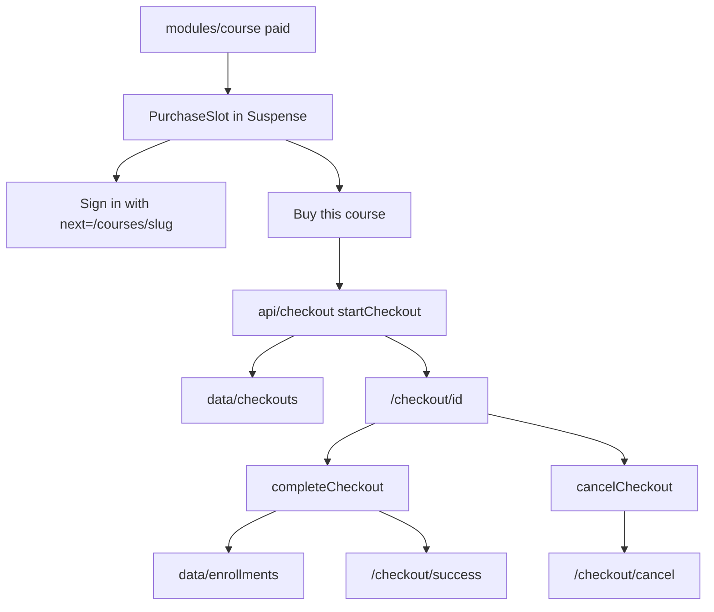

# Phase 8 — Demo payments (implementation plan)

Checkout for a paid course: an in-memory session, then a success or cancel page. Nothing is charged. No card field is rendered.

Stop when this phase is done. No lesson player, progress, reviews, or a live payment provider.

**Already in the repo (do not rewrite):** the app shell, home, catalog, course detail, simulated session, free enroll, and My learning. `paths.checkout`, `paths.checkoutSuccess`, and `paths.checkoutCancel` exist. `/checkout` is already a private prefix: a signed-out visit redirects to sign-in with `next` set to that path. A signed-in visit still falls through to the locale not-found. `enrollFree` ignores a paid slug.

**Before writing Next.js APIs:** `cookies()`, `params`, and `searchParams` are request-time. With Cache Components they stay inside `<Suspense>` so the checkout heading can prerender. Do not put checkout rows behind `'use cache'` — they are per student and live in process memory. Do not call `new Date()`. Do not seal a checkout into the cookie. `redirect` comes from `@/i18n/navigation`. A server action cannot call `getLocale()`; the form posts the locale, same as enroll. `/checkout/success` and `/checkout/cancel` are static segments, so `[sessionId]` does not capture them. Do not add a card number, expiry, CVC, or name-on-card field.



## Target tree (new or changed)

```
src/content/en.json, ar.json
src/data/checkouts.ts
src/api/checkouts.ts
src/api/checkout.ts
src/api/enroll.ts                          (comment only)
src/modules/course/purchase.tsx, purchase-form.tsx
src/modules/course/index.tsx
src/modules/checkout/
src/app/[locale]/checkout/[sessionId]/page.tsx, loading.tsx, error.tsx, not-found.tsx
src/app/[locale]/checkout/success/page.tsx, loading.tsx, error.tsx
src/app/[locale]/checkout/cancel/page.tsx, loading.tsx, error.tsx
```

No new dependency. No proxy change. Free courses still use `enrollFree`. Checkout is not a header or footer link.

## Step 1 — Branch

Branch from current `master`: `feat/phase-08-demo-payments`.

## Step 2 — Copy

`brandName` stays `"Vela"`.

| Key                         | EN (intent)                                                                 |
| --------------------------- | --------------------------------------------------------------------------- |
| `learning.intro`            | Courses you enroll in show up here.                                         |
| `checkout.title`            | Checkout                                                                    |
| `checkout.intro`            | This is a demo checkout. No card is collected and nothing is charged.       |
| `checkout.buy`              | Buy this course                                                             |
| `checkout.buyPending`       | Starting checkout                                                           |
| `checkout.signIn`           | Sign in to buy                                                              |
| `checkout.total`            | Total                                                                       |
| `checkout.pay`              | Complete demo purchase                                                      |
| `checkout.payPending`       | Completing purchase                                                         |
| `checkout.cancel`           | Cancel checkout                                                             |
| `checkout.cancelPending`    | Canceling                                                                   |
| `checkout.paid`             | This purchase is already complete.                                          |
| `checkout.canceled`         | This checkout was canceled.                                                 |
| `checkout.successTitle`     | Purchase complete                                                           |
| `checkout.successIntro`     | You're enrolled. No charge was made.                                        |
| `checkout.incomplete`       | This purchase isn't complete yet.                                           |
| `checkout.return`           | Return to checkout                                                          |
| `checkout.cancelTitle`      | Checkout canceled                                                           |
| `checkout.cancelIntro`      | No charge was made.                                                         |
| `checkout.unavailableTitle` | Order unavailable                                                           |
| `checkout.unavailable`      | That order isn't available.                                                 |
| `checkout.backToCourse`     | Back to course                                                              |
| `checkout.notFound.title`   | Checkout not found                                                          |
| `checkout.notFound.description` | That checkout doesn't exist on Vela.                                    |
| `checkout.notFound.courses` | Browse courses                                                              |

Arabic: equivalent UI strings. **Vela** stays **Vela** in the not-found line. `learning.intro` no longer says the list is only free courses, because a paid purchase enrolls the same way.

## Step 3 — Checkout store and API

[src/data/checkouts.ts](../src/data/checkouts.ts) is an in-memory list of `{ id, userId, courseSlug, amount, status }`. `status` is `open`, `paid`, or `canceled`. No seed rows. Restarting the server drops every row. The id is `crypto.randomUUID()`, checked with a lowercase UUID pattern so `success` and `cancel` cannot be posted as an id. The amount is the course price at the moment the session opens.

`openCheckout` reuses an open row for the same student and course when the amount still matches. A mismatched open row is canceled and a new id is issued, so a stale total cannot block the button. `markCheckoutPaid` and `markCheckoutCanceled` only change an `open` row owned by that student.

[src/api/checkouts.ts](../src/api/checkouts.ts) `getCheckoutForViewer(id)` reads `getSession()`, returns null for a bad id, a missing row, another student, or a slug that is no longer in the catalog, and otherwise returns the row plus the course. It does not use `'use cache'`.

[src/api/checkout.ts](../src/api/checkout.ts) is `"use server"`: `startCheckout`, `completeCheckout`, `cancelCheckout`.

- Slug: lowercase letters, digits, and single hyphens, max 80 characters. Session id: the UUID pattern. Anything else is ignored.
- No session: redirect to sign-in. `next` is the course path or `/checkout/{id}` when that value is well-formed.
- `startCheckout`: unknown slug or `price <= 0` returns without writing. An existing enrollment redirects to `paths.dashboard()`. Otherwise open a session and redirect to `paths.checkout(id)`.
- `completeCheckout`: unknown or not owned returns. `paid` redirects to success. A non-open row returns. The course must still exist, `price > 0`, and `price` must equal the stored amount. Then `addEnrollment`, mark paid, and redirect to `paths.checkoutSuccess()` with `session` set to the id.
- `cancelCheckout`: a paid row redirects to success and stays paid. An open row is marked canceled. Redirect to `paths.checkoutCancel()` with `session` set to the id.

No action reads or stores a card number.

## Step 4 — Course page

[src/modules/course/index.tsx](../src/modules/course/index.tsx) renders the purchase slot when `price !== 0`, inside `<Suspense>`. Free courses keep the enroll slot.

[src/modules/course/purchase.tsx](../src/modules/course/purchase.tsx) reads `getEnrollmentState`.

- **Guest:** the demo intro, then a link “Sign in to buy” to sign-in with `next` set to this course. It is a link, not a submit.
- **Open:** the demo intro, then [src/modules/course/purchase-form.tsx](../src/modules/course/purchase-form.tsx) posts `startCheckout`. The button is disabled while pending, the label switches to the pending string, and a polite status repeats it. `aria-busy` on the button.
- **Enrolled:** “You're enrolled.” and a link to the dashboard. No second purchase control.

The fallback is the intro line and a button-sized bar. `role="status"` with the existing sr-only `loading.label`. `aria-hidden` on the bars only.

## Step 5 — Checkout, success, and cancel

[src/app/[locale]/checkout/[sessionId]/page.tsx](../src/app/[locale]/checkout/[sessionId]/page.tsx) renders the module. Document title is `Vela · {title}` (`absolute`). The module does not add another `<main>`.

[src/modules/checkout/index.tsx](../src/modules/checkout/index.tsx) is a Server Component. One `getTranslations()` in each component. Content width `max-w-6xl` and `px-4`, with the copy in `max-w-3xl`.

- `h1` is Checkout. The demo intro sits under it. Both are outside Suspense.
- The body awaits `params` and the session under Suspense. No session: redirect to sign-in.
- Bad id, unknown id, or another student's row: `notFound()`.
- **Open:** course title links to the course, the stored total is USD with `dir="ltr"`, then pay and cancel. Pay posts `completeCheckout`. Cancel posts `cancelCheckout`. Separate forms so only the clicked button goes pending.
- **Paid:** `checkout.paid`, the course, the total, and a link to My learning. No pay control.
- **Canceled:** `checkout.canceled` and a link back to the course. No pay control.

[src/modules/checkout/outcome.tsx](../src/modules/checkout/outcome.tsx) is the success and cancel body. The heading depends on the row, so it awaits `searchParams` and the session under Suspense.

- No session: redirect to sign-in.
- Missing or not owned: `checkout.unavailableTitle`, `checkout.unavailable`, and My learning.
- Success page and `paid`: success title, success intro, course title, total, My learning.
- Cancel page and `canceled`: cancel title, cancel intro, course title, and back to the course.
- A `paid` row on the cancel page uses the paid copy and My learning.
- A `canceled` row on the success page uses the canceled copy and the course link.
- An `open` row uses `checkout.incomplete` and a link back to that checkout.

The `session` query is the checkout id. A value that fails the UUID check is treated as missing.

## Step 6 — Loading, error, and not-found

[src/app/[locale]/checkout/[sessionId]/loading.tsx](../src/app/[locale]/checkout/[sessionId]/loading.tsx): skeleton of the title, intro, course, total, and actions. `role="status"` with the existing sr-only `loading.label`. `aria-hidden` on the decorative bars only. The Suspense fallback inside the page is the course block only, so the heading is not duplicated.

Success and cancel `loading.tsx` use the outcome skeleton, including the title, because that title is inside Suspense.

Each of the three segments has `error.tsx`. The message, `retry`, and visible `brandName` match the catalog error, at the same content width. One `useTranslations()`.

`not-found.tsx` exists only on `[sessionId]`. Success and cancel do not call `notFound()`.

## Step 7 — Docs (after the code)

- This plan stays.
- Link it from [roadmap.md](roadmap.md).
- Short note in [architecture.md](architecture.md): demo checkout, in-memory sessions, success and cancel, Suspense around the session read. No card data.
- Short note in [i18n.md](i18n.md): `checkout` copy, USD `dir="ltr"`, the `session` query, and `learning.intro` covering paid enrollments.

Comments only where non-obvious (memory is not the cookie, no card data, Suspense so the shell still prerenders, static success and cancel segments, stale open session is replaced).

## Step 8 — Verify (required before calling the phase done)

Run `npm run dev` and `npm run build`. In the browser:

1. Signed out, a paid course shows the price, the demo intro, and “Sign in to buy”. No card field. A free course still shows “Sign in to enroll” and no buy control. **Vela** stays untranslated. Arabic sets `dir="rtl"`.
2. That sign-in link opens sign-in with `next` set to the course. The demo student signs in and returns to that course.
3. “Buy this course” shows the pending label, then the checkout page shows the course, the USD total, and the demo intro. The page has no card field. “Complete demo purchase” shows the pending label, then the success page. My learning lists that course once. The course shows “You're enrolled.”
4. Canceling a second paid course shows the pending label, then the cancel page, and does not add the course to My learning. Starting checkout again after cancel opens a new session and can complete.
5. Completing the same open session twice does not duplicate the enrollment. A paid session URL no longer shows the pay button.
6. A made-up `/checkout/{id}` renders the checkout not-found inside the shell. Signed out, `/en/checkout/success` redirects to sign-in with `next=/checkout/success`.
7. Header and footer links stay Home, Courses, and the account links. Checkout is not in either list. The language switch stays on checkout, success, and cancel.
8. Narrow viewport: the pay and cancel controls wrap and the price stays in Latin digits. Desktop: the checkout column stays readable. Focus-visible shows on the buy control, pay, cancel, and the course link.
9. Checkout loading skeleton matches the page and exposes a status message. Error UI retries and shows Vela.
10. Home, catalog, a free course, My learning, and sign-in still render. Production build succeeds with `cacheComponents`.

Exercise both locales, a free course, a paid course, cancel, success, an unknown checkout id, and desktop plus a narrow viewport.

## Out of scope

The lesson player and progress (Phase 9), reviews, live charges, card collection, a persistent checkout database, tests, git push.

## Git

Commit on `feat/phase-08-demo-payments` after each finished concern (copy, checkout data and API, routes and checkout UI, loading/error/not-found, docs). Do not commit on `master` except the merge when the phase is done. Do not push. Do not edit the Next.js-managed `AGENTS.md` block.
