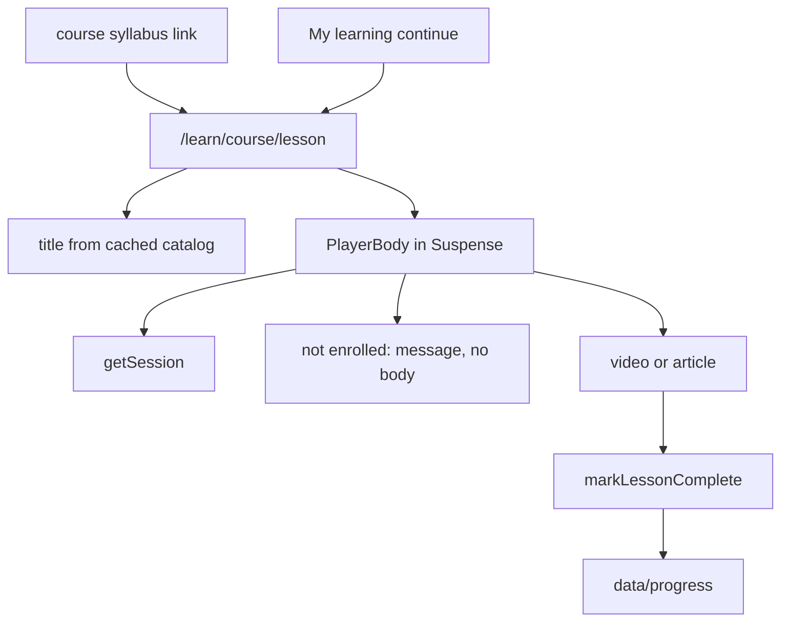

# Phase 9 — Player (implementation plan)

Play one lesson at `/learn/{courseSlug}/{lessonSlug}`: an HTML5 video or an article, plus completion that My learning and the course page can resume. The segment ships with `loading.tsx`, `error.tsx`, and `not-found.tsx`.

Stop when this phase is done. No reviews, watch-position tracking, or a real backend.

**Already in the repo (do not rewrite):** the app shell, home, catalog, course detail, simulated session, enrollment, demo checkout, and `src/proxy.ts`. `paths.learn` exists. `/learn` is already a private prefix: a signed-out visit redirects to sign-in with `next` set to that path. A signed-in visit to bare `/learn` still falls through to the locale not-found. Syllabus rows are titles, not links.

**Before writing Next.js APIs:** `params` is a promise. `generateStaticParams` returns every catalog lesson, so the page may await `params` and prerender the title. A pair that is not in the catalog still matches the dynamic segments and calls `notFound()`. `cookies()` stays inside `<Suspense>` so that title can prerender. Do not put completion rows behind `'use cache'` — they are per student and live in process memory. Do not call `new Date()`. Do not seal completion into the cookie. `redirect` comes from `@/i18n/navigation`. A server action cannot call `getLocale()`; the form posts the locale, same as enroll. Completion is an explicit mark, not a playback percentage. Do not add a markdown or video dependency.



## Target tree (new or changed)

```
src/content/en.json, ar.json
src/lib/lessons.ts
src/data/progress.ts
src/api/progress.ts
src/api/learn.ts
src/modules/player/
src/modules/course/enrolled.tsx, index.tsx, enroll.tsx, purchase.tsx
src/modules/learning/index.tsx, skeleton.tsx
src/app/[locale]/learn/[courseSlug]/[lessonSlug]/page.tsx, loading.tsx, error.tsx, not-found.tsx
```

No new dependency. No proxy change. The player is not a header or footer link.

## Step 1 — Branch

Branch from current `master`: `feat/phase-09-player`.

## Step 2 — Copy

`brandName` stays `"Vela"`.

| Key                         | EN (intent)                                                          |
| --------------------------- | -------------------------------------------------------------------- |
| `learning.continue`         | Continue learning                                                    |
| `learning.progress`         | `{completed, number} of {total, plural, one {# lesson} other {# lessons}} complete` |
| `player.backToCourse`       | Back to course                                                       |
| `player.outline`            | Lessons                                                              |
| `player.previous`           | Previous                                                             |
| `player.next`               | Next                                                                 |
| `player.position`           | Lesson {index, number} of {total, number}                            |
| `player.complete`           | Mark complete                                                        |
| `player.completePending`    | Saving                                                               |
| `player.completed`          | Completed                                                            |
| `player.locked`             | Enroll in this course to open this lesson.                           |
| `player.captions`           | Captions                                                             |
| `player.videoUnsupported`   | This browser can't play the video.                                   |
| `player.notFound.title`     | Lesson not found                                                     |
| `player.notFound.description` | That lesson doesn't exist on Vela.                                 |
| `player.notFound.courses`   | Browse courses                                                       |

Arabic: equivalent UI strings, including plural forms. **Vela** stays **Vela** in the not-found line.

## Step 3 — Outline, progress store, and API

[src/lib/lessons.ts](../src/lib/lessons.ts) walks modules in catalog order. `courseLessons` returns each lesson with a 1-based index. `findLesson` returns null when the slug is not on that course. Empty modules add nothing.

[src/data/progress.ts](../src/data/progress.ts) is an in-memory list of `{ userId, courseSlug, lessonSlug }`. No seed rows. Restarting the server drops every row. `markLessonComplete` is idempotent. `completedLessonSlugs` keeps insertion order for one student and course.

[src/api/progress.ts](../src/api/progress.ts) `getProgressForCourses` reads `getSession()`, counts only slugs that are still on the course, and does not use `'use cache'`. `resumeSlug` is the first incomplete lesson, or the first lesson when every lesson is complete, or null when the course has no lessons. `getResumeLesson(slug)` is that slug for one course.

[src/api/learn.ts](../src/api/learn.ts) is `"use server"`: `markLessonComplete`.

- Course and lesson slugs: lowercase letters, digits, and single hyphens, max 80 characters. Anything else is ignored.
- No session: redirect to sign-in. `next` is the lesson path when both slugs are well-formed.
- Unknown course, unknown lesson, or no enrollment: return without writing.
- Otherwise save the row and redirect to that lesson. A second submit does not add a second row.

## Step 4 — Player

[src/app/[locale]/learn/[courseSlug]/[lessonSlug]/page.tsx](../src/app/[locale]/learn/[courseSlug]/[lessonSlug]/page.tsx) awaits `params`, loads the cached course, and calls `notFound()` when the course or the lesson is missing. `generateStaticParams` maps every catalog lesson to `{ courseSlug, lessonSlug }` (the parent already emits `locale`). `generateMetadata` uses the same read: document title `Vela · {lesson title}` (`absolute`) and the course description. The module does not add another `<main>`.

[src/modules/player/index.tsx](../src/modules/player/index.tsx) is a Server Component. One `getTranslations()` in each component. Content width `max-w-6xl` and `px-4`.

- Back link to the course (`player.backToCourse`). `h1` is the lesson title. Type, duration, and position sit under it. Those are public catalog fields and stay outside Suspense.
- The body awaits the session under Suspense. No session: redirect to sign-in with `next` set to this lesson.
- **Not enrolled:** `player.locked`. No `<video>`, no article body, no complete control. Previous, next, and the outline still render, without completion marks.
- **Enrolled, video:** native `<video controls playsInline preload="metadata">` with the lesson poster, an mp4 source, and the unsupported sentence as the element's fallback. A `<track kind="captions">` is included only when this locale has `captionSrcEn` or `captionSrcAr`. The accessible name is the lesson title.
- **Enrolled, article:** [src/modules/player/article.tsx](../src/modules/player/article.tsx) splits the locale body on blank lines. A block that starts with `## ` is an `h2`. Every other block is a paragraph. Text nodes only. A leading `##` that repeats the lesson title is omitted because the `h1` already says it.
- **Enrolled:** `learning.progress`, then [src/modules/player/complete-form.tsx](../src/modules/player/complete-form.tsx). The button is disabled while pending, the label switches to the pending string, and a polite status repeats it. `aria-busy` on the button. A completed lesson shows `player.completed` and no button.
- Previous and next show the neighbor's title. A course with one lesson has neither.
- The outline is a nav labelled by its heading. The current lesson is text with `aria-current="page"`. Other lessons are links. A completed lesson also shows the word Completed.

On a wide viewport the outline sits at the inline end. On a narrow viewport it follows the lesson and the previous/next controls wrap.

## Step 5 — Syllabus, course action, and My learning

Syllabus titles on the course page become links to `paths.learn`. Type and duration stay outside the link. The public page still prerenders; the player gates the body.

[src/modules/course/enrolled.tsx](../src/modules/course/enrolled.tsx) replaces the enrolled branch of free enroll and demo purchase. It keeps “You're enrolled.” and the dashboard link, and adds Continue learning when the course has a lesson. Free enroll still redirects to My learning.

My learning, under each card, shows `learning.progress` and Continue learning when the course has lessons. The shared course card stays unchanged. The list skeleton grows a progress line and a continue line under each card.

## Step 6 — Loading, error, and not-found

[src/app/[locale]/learn/[courseSlug]/[lessonSlug]/loading.tsx](../src/app/[locale]/learn/[courseSlug]/[lessonSlug]/loading.tsx): skeleton of the back link, title, meta, media, action, pager, and outline. `role="status"` with the existing sr-only `loading.label`. `aria-hidden` on the decorative bars only. The Suspense fallback inside the page is the body only, so the heading is not duplicated.

`error.tsx` matches the course error: message, `retry`, and visible `brandName`, at the same content width. One `useTranslations()`.

`not-found.tsx` uses `player.notFound` and links to the catalog. Bare `/learn` and `/learn/{one-segment}` still use the locale not-found.

## Step 7 — Docs (after the code)

- This plan stays.
- Link it from [roadmap.md](roadmap.md).
- Short note in [architecture.md](architecture.md): player route, enrollment gate, in-memory completion, Suspense around the session read. Syllabus titles link here. Bare `/learn` still has no page.
- Short note in [i18n.md](i18n.md): `player` copy, locale-independent lesson slugs, article text from the record, progress counts, and **Vela** in the not-found line.

Comments only where non-obvious (memory is not the cookie, Suspense so the title still prerenders, article text is not HTML, resume falls back to the first lesson, a repeated markdown title is omitted).

## Step 8 — Verify (required before calling the phase done)

Run `npm run dev` and `npm run build`. In the browser:

1. Signed out, a course syllabus links each lesson. Opening one redirects to sign-in with `next` set to that lesson. No video or article body is on the sign-in page. **Vela** stays untranslated. Arabic sets `dir="rtl"`.
2. The demo student signs in and lands on the lesson. Before enrollment the page shows the title and the locked message, and no `video` element or article paragraph.
3. Enrolling in the free course and choosing Continue learning opens the first lesson. A video lesson shows controls and the sample source. An article shows the paragraph without a raw `##`. Mark complete shows the pending label, then Completed. My learning shows 1 of 2 lessons complete for that course.
4. The next lesson opens from the outline. Completing it shows 2 of 2. Continue learning still opens a lesson. Marking the same lesson again does not add a second row.
5. A paid course stays locked until demo checkout enrolls it. After that, Continue learning opens the lesson.
6. `/en/learn/intro-web-development/missing` renders the lesson not-found inside the shell. Signed out, a lesson URL redirects to sign-in. Signed in, bare `/en/learn` stays the locale not-found.
7. Header and footer links stay Home, Courses, and the account links. The player is not in either list. The language switch stays on the same lesson.
8. Narrow viewport: the outline follows the lesson and the pager wraps. Desktop: the outline sits beside the lesson. Focus-visible shows on the syllabus link, mark complete, previous or next, and the outline link.
9. The lesson loading skeleton matches the page and exposes a status message. Error UI retries and shows Vela.
10. Home, catalog, a free course, My learning, and sign-in still render. Production build succeeds with `cacheComponents`.

Exercise both locales, a video lesson, an article lesson, a locked lesson, an unknown lesson, and desktop plus a narrow viewport.

## Out of scope

Reviews (Phase 10), playback position, auto-complete when a video ends, unenroll, a persistent progress database, tests, git push.

## Git

Commit on `feat/phase-09-player` after each finished concern (copy, progress data and API, routes and player UI, loading/error/not-found, docs). Do not commit on `master` except the merge when the phase is done. Do not push. Do not edit the Next.js-managed `AGENTS.md` block.
