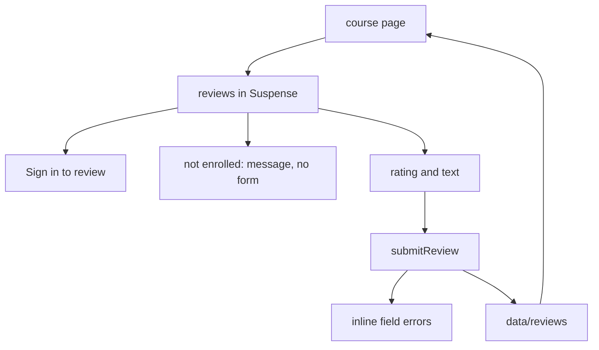

# Phase 10 — Reviews (implementation plan)

List reviews on the course page and let an enrolled student submit one. Invalid rating or text returns inline errors. The submit control shows a pending state.

Stop when this phase is done. No edit or delete controls, catalog ratings, review JSON-LD, or a real backend.

**Already in the repo (do not rewrite):** the app shell, home, catalog, course detail, simulated session, enrollment, demo checkout, and the lesson player. The course segment already has `loading.tsx`, `error.tsx`, and `not-found.tsx`. Reviews are not a new route and not a header or footer link.

**Before writing Next.js APIs:** the course page can still prerender. Review rows and the session cookie stay inside `<Suspense>`. Do not put reviews behind `'use cache'` — they are per student and live in process memory. Do not call `new Date()`. Do not seal a review into the cookie. `redirect` comes from `@/i18n/navigation`. A server action cannot call `getLocale()`; the form posts the locale, same as enroll. The action uses `useActionState` so a failed submit can return field errors without clearing what was typed. A successful submit redirects so the list renders the new row. Do not add a moderation queue or a rich-text editor.



## Target tree (new or changed)

```
src/content/en.json, ar.json
src/lib/review-fields.ts
src/data/reviews.ts
src/api/reviews.ts
src/api/review.ts
src/modules/course/reviews.tsx, review-form.tsx, index.tsx, skeleton.tsx
```

No new dependency. No proxy change. No `paths.ts` change. Course JSON-LD stays the catalog description.

## Step 1 — Branch

Branch from current `master`: `feat/phase-10-reviews`.

## Step 2 — Copy

`brandName` stays `"Vela"`.

| Key | EN (intent) |
| --- | --- |
| `reviews.title` | Reviews |
| `reviews.empty` | No reviews yet. |
| `reviews.count` | `{count, plural, one {# review} other {# reviews}}` |
| `reviews.average` | `{rating, number, ::.0} out of {scale, number}` |
| `reviews.write` | Write a review |
| `reviews.ratingLabel` | Rating |
| `reviews.stars` | `{count, plural, one {# star} other {# stars}}` |
| `reviews.bodyLabel` | Review |
| `reviews.submit` | Submit review |
| `reviews.pending` | Submitting |
| `reviews.signIn` | Sign in to review |
| `reviews.enroll` | Enroll in this course to write a review. |
| `reviews.yours` | Your review |
| `reviews.errors.rating` | Choose a rating from 1 to 5. |
| `reviews.errors.body` | Write at least 10 characters. |
| `reviews.errors.bodyLong` | Use 500 characters or fewer. |
| `reviews.errors.enrolled` | Enroll in this course before reviewing it. |

Arabic: equivalent UI strings, including plural forms. The average and the star count follow the page locale.

## Step 3 — Store, validation, and API

[src/data/reviews.ts](../src/data/reviews.ts) is an in-memory list of `{ userId, courseSlug, authorName, rating, body }`. No seed rows. Restarting the server drops every row. One row per student and course. `saveReview` updates that row in place when it already exists. `listReviews` returns that course's rows, newest first.

[src/lib/review-fields.ts](../src/lib/review-fields.ts) reads the posted rating and body. Rating is an integer from 1 to 5. Body is trimmed, keeps newlines, and rejects other control characters. Shorter than 10 characters is `body`. Longer than 500 is `bodyLong`. The action translates nothing; it returns those keys.

[src/api/reviews.ts](../src/api/reviews.ts) `getCourseReviews` reads `getSession()` and does not use `'use cache'`. Each row includes `own` for the signed-in student. `viewer` is `guest`, `locked` (signed in, not enrolled), or `enrolled`.

[src/api/review.ts](../src/api/review.ts) is `"use server"`: `submitReview(prev, formData)`.

- Course slug: lowercase letters, digits, and single hyphens, max 80 characters.
- No session: redirect to sign-in. `next` is the course path when the slug is well-formed.
- Invalid rating or body: return field errors and do not write.
- Unknown course, or a slug that is not well-formed: return without writing.
- Signed in but not enrolled: return `formError: "enrolled"` and do not write.
- Otherwise save the row (a second submit updates it) and redirect to that course with `#reviews`.

## Step 4 — Course page

The reviews section sits under the syllabus, inside the same `max-w-3xl` column. `id="reviews"` and `scroll-mt-24` clear the sticky header. The `h2` is `reviews.title` and stays outside Suspense so the heading can prerender. The list and the composer are [src/modules/course/reviews.tsx](../src/modules/course/reviews.tsx), wrapped in Suspense. One `getTranslations()` in each component.

- No rows: `reviews.empty`.
- Rows: the average (`scale` is 5), the count, then a list. The author name and the body use `dir="auto"`. The body is text, with newlines preserved. The rating is `reviews.stars`. The signed-in student's row also shows `reviews.yours`.
- **Guest:** `reviews.write` and a sign-in link. `next` is this course. No fields.
- **Locked:** `reviews.write` and `reviews.enroll`. No fields.
- **Enrolled, no review yet:** [src/modules/course/review-form.tsx](../src/modules/course/review-form.tsx). A rating group of five radios and a textarea. `noValidate`. Values stay controlled so a failed action does not clear them. The posted rating is a hidden field, because a finished action clears the native radio selection; an effect puts that selection back. Each error is an alert tied to its field with `aria-invalid` and `aria-describedby`. Focus moves to the rating, then the body, then a form-level error. The button is disabled while pending, the label switches to the pending string, and a polite status repeats it. `aria-busy` on the form and the button.
- **Enrolled, already reviewed:** no form.

On a narrow viewport the radios wrap and the fields use the full column. The section does not sit beside the syllabus.

## Step 5 — Loading

The course segment already has `error.tsx` and `not-found.tsx`. This phase does not add a route.

[src/modules/course/skeleton.tsx](../src/modules/course/skeleton.tsx) grows a reviews block under the syllabus bars: heading, summary, two rows, and the form. `loading.tsx` already exposes `role="status"` with `loading.label`. `aria-hidden` stays on the decorative bars only.

The Suspense fallback inside the page is the list and the form, not a second heading.

## Step 6 — Docs (after the code)

- This plan stays.
- Link it from [roadmap.md](roadmap.md).
- Short note in [architecture.md](architecture.md): reviews on the course page, enrollment gate, in-memory rows, Suspense around the session read. Not in the catalog card or the course JSON-LD.
- Short note in [i18n.md](i18n.md): `reviews` copy, the student's own words with `dir="auto"`, rating counts, and error keys translated by the form.

Comments only where non-obvious (memory is not the cookie, Suspense so the title still prerenders, the body is not HTML, a second save updates the same row).

## Step 7 — Verify (required before calling the phase done)

Run `npm run dev` and `npm run build`. In the browser:

1. Signed out, a course shows Reviews under the syllabus, the empty line, and Sign in to review. No rating control or textarea. **Vela** stays untranslated. Arabic sets `dir="rtl"`.
2. The demo student signs in and returns to the course. Before enrollment the page shows the enroll message and no form. After enrolling in the free course, the form is there.
3. An empty submit shows both inline errors and focuses the rating. A short body keeps what was typed and shows the length error. A body over 500 characters shows the long error. A valid submit shows the pending label, then one review with the student name, Your review, the rating, and the text. The form is gone. The average and the count match that review.
4. A second student can enroll and submit. The list shows two reviews, newest first, and only the signed-in student sees Your review on their own row. Submitting does not add a second row for the same student.
5. A paid course stays locked until demo checkout enrolls it. After that, the form is available.
6. The language switch stays on the same course. The review text is not translated. Arabic labels and counts follow Arabic. The author name and the body keep `dir="auto"`.
7. Narrow viewport: the reviews column stacks and the radios wrap. Desktop: the section stays under the syllabus in the content column. Focus-visible shows on the sign-in link, a rating radio, the textarea, and submit.
8. The course loading skeleton includes the reviews block and exposes a status message. Course error still retries and shows Vela. An unknown course still uses the course not-found.
9. Home, catalog, a lesson, My learning, and sign-in still render. Production build succeeds with `cacheComponents`.

Exercise both locales, an empty list, a validation error, a published review, a locked paid course, and desktop plus a narrow viewport.

## Out of scope

Edit and delete, instructor replies, ratings on catalog cards, review JSON-LD, moderation, Phase 11 polish, tests, git push.

## Git

Commit on `feat/phase-10-reviews` after each finished concern (copy, review data and API, course UI, loading skeleton, docs). Do not commit on `master` except the merge when the phase is done. Do not push. Do not edit the Next.js-managed `AGENTS.md` block.
