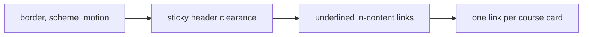

# Phase 11 — Polish (implementation plan)

Accessibility, performance, and leftover interaction details on the pages that already exist. No new routes, no new features, and no loading or error UI that a previous phase already owns.

Stop when this phase is done.

**Already in the repo (do not rewrite):** the shell, home, catalog, course page, simulated session, enrollment, demo checkout, lesson player, and reviews. Each of those segments already has its loading, error, and not-found UI.

**Before writing Next.js APIs:** read `node_modules/next/dist/docs/` for `generate-viewport` and `next/font`. Viewport stays a static export (`colorScheme`, `themeColor`). Do not set `maximumScale` or `userScalable`. Do not add a theme toggle. Do not drop a font weight that the UI uses.



## What this phase changes

Measured against the canvas (`#f6f4ef` / `#101614`):

- `--border` is about 1.3:1 in light and 1.5:1 in dark, so inputs, cards, and filter chips fail the 3:1 boundary check. Light becomes `#818983` (3.27:1). Dark becomes `#626b66` (3.33:1).
- Text contrast for `--foreground`, `--muted`, and `--primary` already clears 4.5:1. Those tokens stay.
- A primary link inside muted text is about 1:1 by luminance. In-content links gain an underline. Header, footer, account, and language links stay in their navs. Filled buttons stay filled.
- Skeleton pulse is the only animation. It stops under `prefers-reduced-motion: reduce`.
- The sticky header can cover a focused control. `scroll-padding-top: 5rem` on `html` clears it. The extra `scroll-mt-*` offsets that were doing the same job come off, so a hash does not add both.
- `color-scheme` follows light and dark, in CSS and in the viewport export, so video controls and other native widgets match the canvas. `themeColor` uses the same two canvas colors.
- Forced-colors focus uses `CanvasText`.
- A course card is one link: the title stretches across the card, and keyboard focus rings the card. The description is not a second control. My learning’s continue link stays outside the card.
- Catalog filter names are paragraphs. They were `h2`s, so the outline was Level, Category, and Price before the result heading. Course cards stay `h3`. My learning’s count becomes the `h2` between the page title and those cards.
- IBM Plex Sans and IBM Plex Sans Arabic load 400, 500, and 600. Nothing uses 700.

No new copy. `brandName` stays `"Vela"`.

## Target tree (changed)

```
src/styles/globals.css
src/lib/fonts.ts
src/app/[locale]/layout.tsx
src/components/course-card.tsx
src/modules/catalog/results.tsx
src/modules/learning/index.tsx
src/modules/course/index.tsx, enrolled.tsx, review-form.tsx
src/modules/player/index.tsx
src/modules/checkout/outcome.tsx
src/modules/auth/field.tsx, sign-in-form.tsx, sign-up-form.tsx
src/app/[locale]/not-found.tsx
src/app/[locale]/courses/[slug]/not-found.tsx
src/app/[locale]/learn/[courseSlug]/[lessonSlug]/not-found.tsx
src/app/[locale]/checkout/[sessionId]/not-found.tsx
```

No new dependency. No proxy, `paths.ts`, or data change.

## Step 1 — Branch

Branch from current `master`: `feat/phase-11-polish`.

## Step 2 — Tokens, motion, scheme, type

[src/styles/globals.css](../src/styles/globals.css) holds the border values, `color-scheme`, `scroll-padding-top`, the reduced-motion override for `.animate-pulse`, and the forced-colors focus color.

[src/app/[locale]/layout.tsx](../src/app/[locale]/layout.tsx) exports a static `viewport`: `colorScheme: "light dark"` and `themeColor` for the two canvas colors. `<main>` keeps `tabIndex={-1}` and `outline-none`, and loses `scroll-mt-20`.

[src/lib/fonts.ts](../src/lib/fonts.ts) drops weight `700` from both families. `adjustFontFallback: false` on the Latin face stays, so the Arabic face still supplies Arabic glyphs.

The reviews hash, the review fields, and the account fields lose `scroll-mt-24`.

## Step 3 — Links, cards, headings

Underline `underline-offset-4` on in-content links: back links, syllabus and outline titles, the lesson pager, clear filters, continue and My learning text links, the checkout course title, auth cross-links, and each not-found link.

[src/components/course-card.tsx](../src/components/course-card.tsx): the article is `relative` and `course-card`. The title link’s `::after` covers the card (`after:inset-0 after:z-10`). Hover uses the primary border. Focus draws one ring on the article. `.course-card a:focus-visible` is unlayered so it can clear the global focus outline on the title.

[src/modules/catalog/results.tsx](../src/modules/catalog/results.tsx): each filter label is a `p` with the same `id`, so `aria-labelledby` on the chip list is unchanged.

[src/modules/learning/index.tsx](../src/modules/learning/index.tsx): the count is an `h2` with the same visual classes.

## Step 4 — Docs (after the code)

- This plan stays.
- Link it from [roadmap.md](roadmap.md).
- Short note in [architecture.md](architecture.md): border contrast, color scheme, sticky-header clearance, reduced motion, underlined in-content links, one link per card, catalog filter labels outside the heading outline, three font weights.
- No new strings, so [i18n.md](i18n.md) stays as it is.

Comments only where non-obvious (why the border is darker, why scroll-padding replaces scroll-margin, why the card is one link, why 700 is gone).

## Step 5 — Verify (required before calling the phase done)

Run `npm run dev` and `npm run build`. In the browser:

1. Home, catalog, a course, a lesson, My learning, and sign-in still render. **Vela** stays untranslated. Arabic sets `dir="rtl"`.
2. Cards, inputs, and filter chips have a visible border in light and dark. A primary button label still clears the fill. Focus is visible on a card, a text link, a filled button, and a nav link, and it is not hidden under the header.
3. Clicking a course card’s description opens the course. The card exposes one link. Keyboard focus rings the card. On My learning, Continue stays a separate link under the card.
4. Catalog headings are the page title, then the result count, then course titles. Level, Category, and Price are not headings. Clear filters is underlined. A selected chip stays filled.
5. Syllabus titles, the lesson pager, and the outline titles are underlined. The back link is underlined. Filled actions (Browse courses, Enroll, Submit) are not.
6. Sign-up’s “Sign in” link is underlined inside the muted sentence. The language switch and the header nav are not underlined.
7. `#reviews` and a focused field sit below the sticky header. The skip link still moves focus to `main`.
8. With reduced motion, a skeleton bar does not pulse. The document exposes `color-scheme: light dark` and both theme colors. The font request does not include weight 700.
9. Production build succeeds with `cacheComponents`.

Exercise both locales, light and dark, a narrow viewport, a card click that is not on the title, and keyboard focus.

## Out of scope

A theme toggle, new pages, review edit or delete, catalog ratings, loading or error UI for existing routes, tests, git push.

## Git

Commit on `feat/phase-11-polish` after the polish lands, then again for the docs. Do not split the scroll-padding change from the `scroll-mt-*` removal. Do not commit on `master` except the merge when the phase is done. Do not push. Do not edit the Next.js-managed `AGENTS.md` block.
